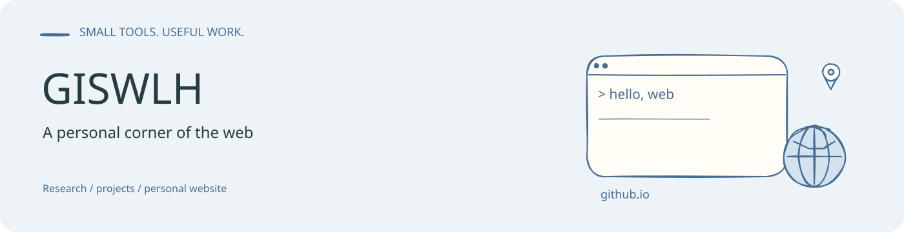
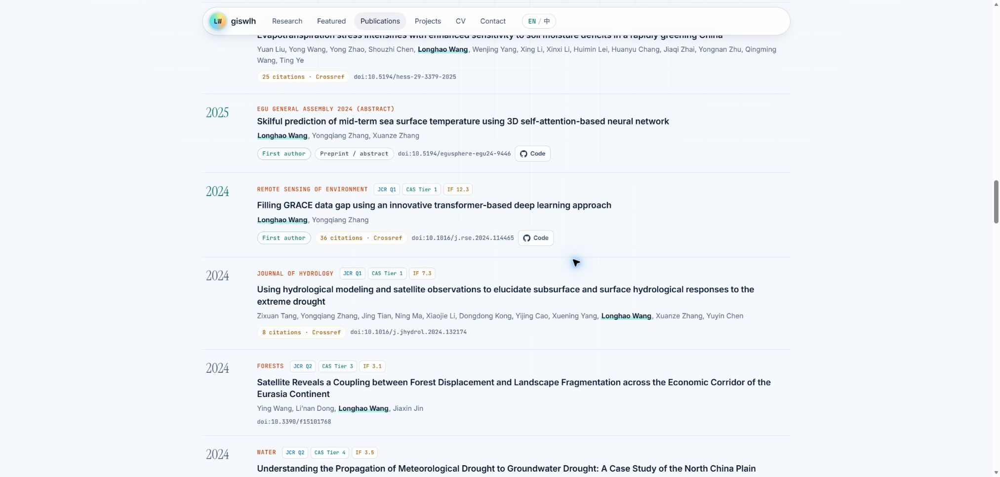

# GISWLH.github.io

王龙浩的个人学术主页，围绕水文与气候人工智能展示研究方向、代表论文、开源项目、个人履历和联系方式。页面提供中英文切换，采用 HTML、CSS 和 JavaScript 实现。

**访问网站：[giswlh.github.io](https://giswlh.github.io/)**

## 页面内容

- 水文与气候研究方向，包括次季节至季节预测、GRACE、蒸散发及物理约束模型。
- 代表论文、论文列表及相关外部链接。
- 开源项目卡片、个人履历与联系方式。
- 杂志封面式首页、多平台链接，以及可悬停读数的海温距平示意图。

## 文件组织

| 路径 | 用途 |
| --- | --- |
| [index.html](index.html) | 页面结构、中英文文案和学术内容 |
| [assets/css/style.css](assets/css/style.css) | 页面布局、配色与响应式样式 |
| [assets/js/main.js](assets/js/main.js) | 页面交互逻辑与海温示意图绘制 |
| [assets/img](assets/img) | 头像、图标、分享图和海陆掩膜 |
| [robots.txt](robots.txt)、[sitemap.xml](sitemap.xml) | 搜索引擎抓取入口 |

## 本地预览与维护

本仓库为静态站点，无需先构建前端包。在仓库根目录使用可用的静态文件服务器，例如：

```bash
python -m http.server 8000
```

在浏览器打开 `http://localhost:8000`。修改学术内容时同时检查中英文文案；更新链接后检查导航、论文链接、项目卡片和移动端布局。站点根目录保留 `.nojekyll`，用于直接提供静态资源。

首页横幅的可编辑源文件：[banner.excalidraw](assets/readme/banner.excalidraw)。


<!-- readme-visual-refresh:additional-result -->
## Project output preview



已部署个人学术网站的实际浏览器截图，展示论文列表、年份分类与论文链接；截图于2026年10月17日取得。

[Original source](https://giswlh.github.io/). Captured from the deployed website on 17 October 2026; no local substitute page was used.
<!-- /readme-visual-refresh:additional-result -->
